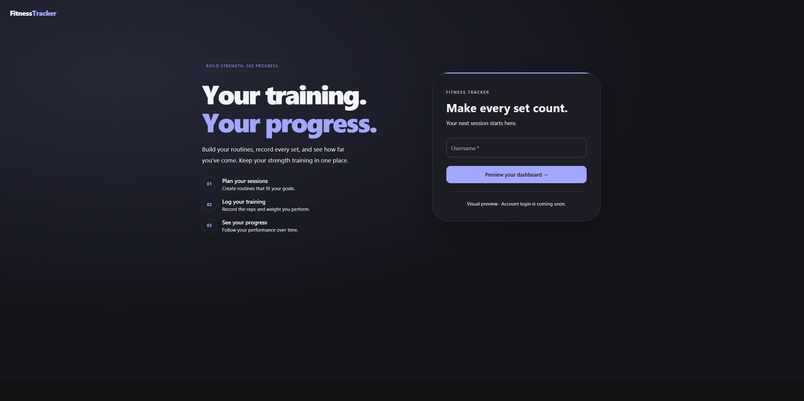
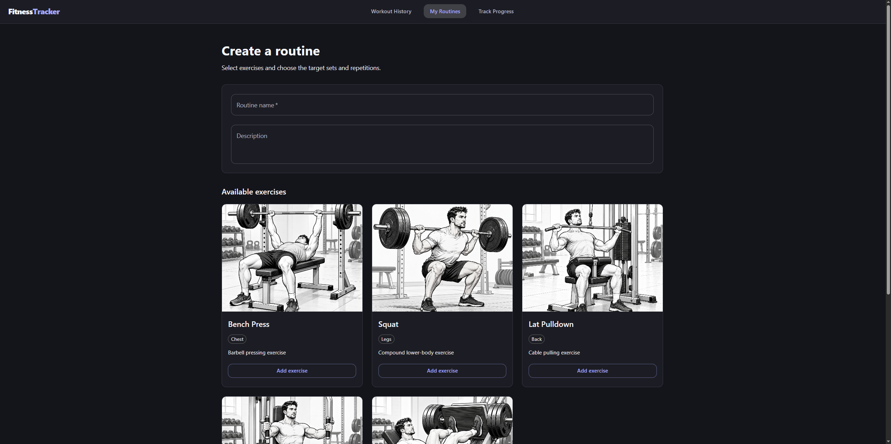
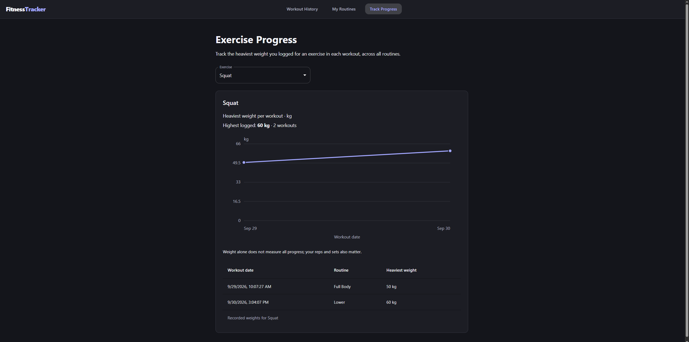

# FitnessTracker

A full-stack strength-training application built with React,
ASP.NET Core, and MySQL. Users can create reusable routines,
record workout sets, and track exercise progress over time.

## Screenshots

### Welcome page

### Routines

### Progress

## Features

- Create, view, edit, and delete workout routines.
- Configure target sets and repetitions for each exercise.
- Log the weight and repetitions performed in a workout.
- Review completed workouts.
- Track the heaviest weight logged per exercise in each workout.
- Responsive Material UI interface with a shared dark theme.

### Planned

- User accounts and authentication
- Hosting and automated deployment